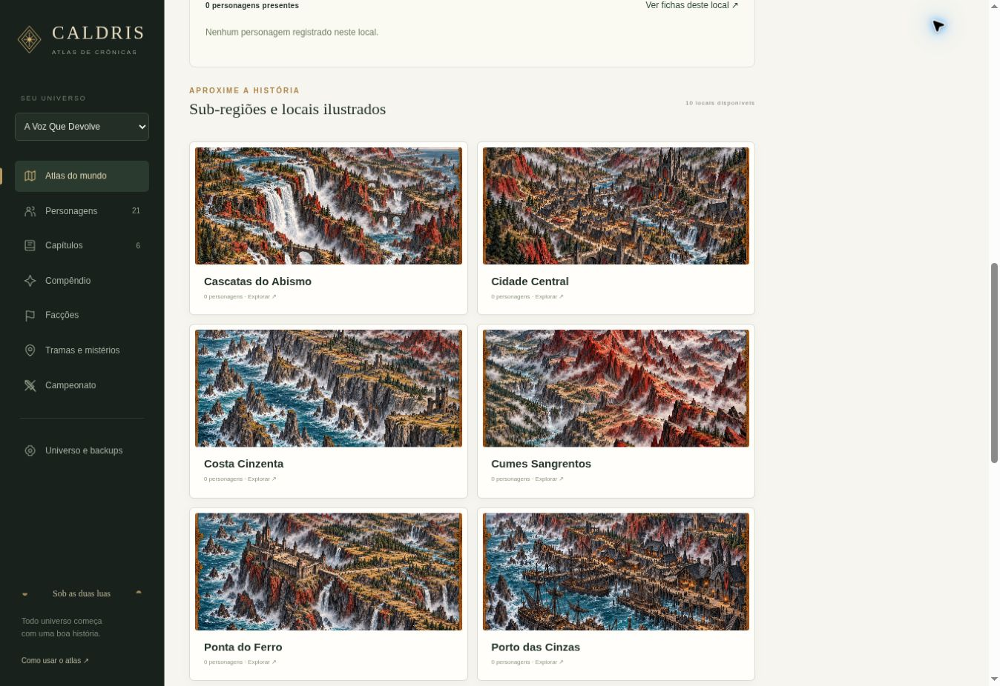

# Padrão de imagens e novas sub-regiões

A referência é a organização enviada nos commits `444ec19` (`imagens`) e `28a4787` (`MAPAS`), além de `5a5eb94` (Hallow). Os originais são mantidos nos seus caminhos, com a mesma grafia, caixa, espaços e acentos. Linux e Vercel distinguem maiúsculas de minúsculas: `MOnzai.png` e `Monzai.png` são nomes diferentes.

| Tipo | Caminho de referência |
| --- | --- |
| Cards completos | `dist/assets/Cards/Borin.png`, `Celina.png`, `Elric.png`, `Lyra.png`, `MOnzai.png`, `SirCaedmon.png`, `Varrick.png`, `Vesk.png`, `Yuki.png` |
| Referências de composição | `dist/assets/Cards/Base de cards/` |
| Mapa do reino | `dist/assets/Mapa/Mapa.png` |
| Mapas regionais | `dist/assets/Mapa/Regiões/` |
| Locais de Brennford | `dist/assets/Mapa/Regiões/Brennford-Subregioes/Brennford - <Local>.png` |
| Locais de Thornwick | `dist/assets/Mapa/Regiões/Thornwick-Subregioes/Thornwick - <Local>.png` |
| Locais de Hallow | `dist/assets/Mapa/Regiões/Hallow-Subregioes/Hallow - <Local>.png` |
| Miniaturas de fichas | `dist/assets/Cards/Miniaturas/<Nome do card>.webp` |
| Mapa anterior arquivado | `dist/assets/Mapa/Arquivo/Mapa anterior.webp` |

Os nomes regionais já existentes, inclusive `Região Ducato Valarde.png`, `Região Harrow.png`, `Região Ponte de pedra.png`, `RegiãoBrandt.png`, `RegiãoBrennford.png`, `RegiãoCaldrisReal.png`, `RegiãoDurnholm.png`, `RegiãoHallow.png` e `Regiãothornwick.png`, permanecem intactos.

Derivadas WebP usam o mesmo diretório e nome-base do original. Exemplo: `Brennford - Capela de Pedra Negra.png` → `Brennford - Capela de Pedra Negra.webp`. O aplicativo usa a derivada quando existe; o PNG continua versionado. Os antigos caminhos planos são preservados para compatibilidade, mas não são o padrão para novos assets. Os arquivos em `Base de cards` são referências, não fichas novas do jogo.

## Adicionar os próximos mapas de locais

1. Crie uma pasta `dist/assets/Mapa/Regiões/<Região>-Subregioes/`.
2. Coloque imagens com o padrão exato `<Região> - <Local>.png` (também aceita JPEG e WebP). O prefixo do arquivo deve corresponder ao nome da pasta. Mantenha o nome-base ao acrescentar uma derivada WebP.
3. Execute `npm run assets` ou `npm run build`, depois `npm test`. Isso atualiza `dist/features/atlas/data/catalog.generated.js`. Não edite esse arquivo manualmente. O build da Vercel executa a descoberta novamente.
4. Versione os novos assets, o catálogo gerado e eventuais ajustes em `assets.config.json`; publique uma nova implantação. Atualize a página no mesmo endereço e perfil em que sua campanha está salva.

As pastas `Brennford-Subregioes`, `Thornwick-Subregioes`, `Durnholm-Subregioes`, `Harrow-Subregioes`, `Velarde-Subregioes`, `Hallow-Subregioes`, `Brandt-Subregioes`, `Caldris-Subregioes`/`Caldris Real-Subregioes` e `Dunmere-Subregioes` já têm associação prevista em `assets.config.json`. Acrescentar arquivos nessas pastas não exige editar a lógica da aplicação. Uma pasta nova desconhecida gera aviso no build: associe seu nome normalizado a um `regionId` em `parents` antes de esperar que apareça numa região.

`placements` permite definir `locationId`, `x`, `y` e `summary` para cada chave de arquivo, como `thornwick-catedral-das-passagens`. A chave é derivada do nome completo, sem acentos, em minúsculas e com hífens. Os nomes exibidos e os caminhos originais preservam acentos e caixa. IDs e nomes-base são identidades estáveis: renomeá-los depois representa um novo local, não uma alteração de imagem.

Se não houver coordenadas configuradas, o sistema reutiliza uma localidade existente pelo nome. Se ela não existir, cria um ponto aproximado editável em grade e usa um resumo neutro; não inventa acontecimentos ou moradores. Ajuste contornos, localização e resumo em **Universo e backups**, ou use **Delimitar região**. Localidades que já foram editadas têm prioridade sobre coordenadas novas do catálogo.

Locais sem imagens continuam como pontos de interesse. Regiões sem sub-regiões ilustradas permanecem navegáveis. Imagens são dados opcionais: não são exigidas cenas fictícias para completar todas as regiões.

## Otimização opcional

Para grandes lotes, instale Pillow em um ambiente de desenvolvimento e execute `python3 scripts/optimize_assets.py`. O script preserva os originais, mantém nomes/pastas e só cria WebPs ausentes; `--replace` regenera derivadas. Ele ignora `Base de cards`. Pillow é necessário apenas para essa manutenção, não para usar o jogo nem para construir o site na Vercel.

O ZIP Linux inclui os módulos e imagens de uso e ignora referências de composição e originais que já tenham WebP correspondente, reduzindo o download. O repositório continua guardando os originais. O catálogo gerado também é versionado para que rodar um clone ou ZIP local exija apenas Python.

Imagens carregadas pelo formulário da ficha são dados da campanha em IndexedDB, não arquivos gravados no repositório. Elas continuam nos backups JSON portáteis. Para novos cards iniciais, mantenha `Cards/<Nome>.png`, gere sua derivada e associe explicitamente ao personagem correto; arquivos de card não criam personagens automaticamente.

## Interface verificada

A galeria abaixo foi capturada na prévia de desenvolvimento. Os registros de QA permanecem apenas nesse navegador de teste.

